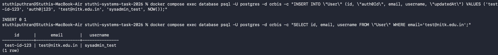
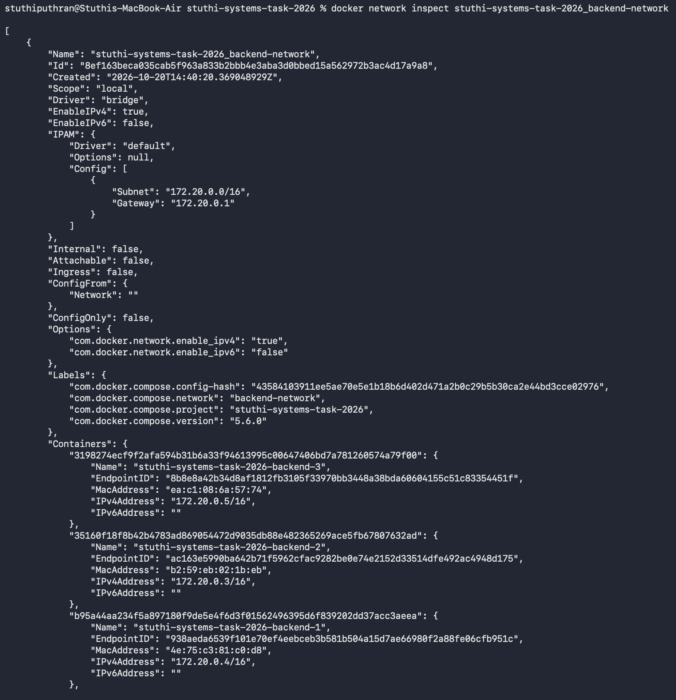
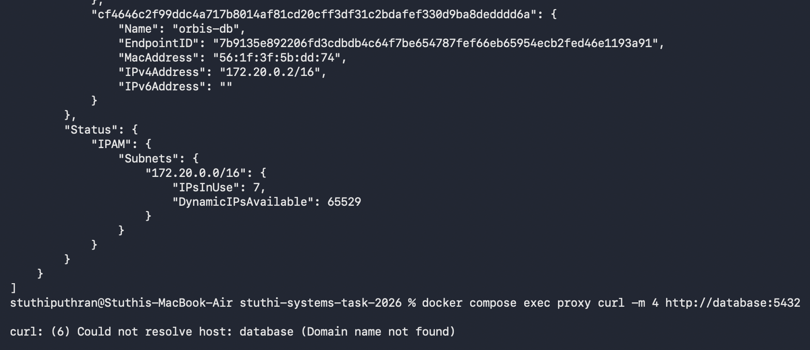
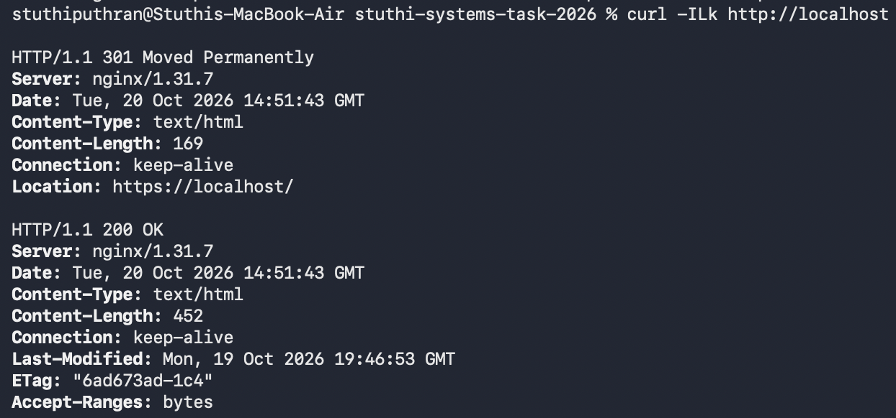
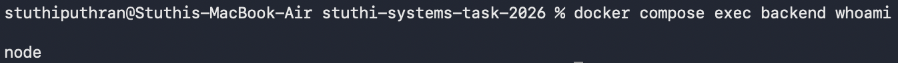

# RECRUITMENT TASK SUBMISSION: CONTAINERIZATION
**Name:** Stuthi Puthran  
**Repository:** stuthi-systems-task-2026  

---

## 🚀 How to Run the Project
Follow these steps from the project root (`stuthi-systems-task-2026`) to get everything running:

1. **Generate the local SSL certificates for Nginx:**
   ```bash
   mkdir -p nginx/ssl && openssl req -x509 -nodes -days 365 -newkey rsa:2048 -keyout nginx/ssl/nginx.key -out nginx/ssl/nginx.crt -subj "/CN=localhost"
   ```
2. **Start up the entire stack:**
   ```bash
   docker compose down && docker compose up --build -d
   ```
3. **Verify all services are running correctly:**
   ```bash
   docker compose ps
   ```

---

## Phase 1: End-to-End Build and Verification

### Debugging Note: Backend Prisma Connection Issues
* **Problem:** During the first couple of runs, the `backend` container kept crashing with an error saying Prisma couldn't connect to the database on port 5432.
* **Root Cause:** The PostgreSQL database container takes a few seconds to fully initialize its internal filesystem and accept connections. The Node backend was trying to run Prisma migrations immediately on startup, hitting the database before it was actually ready.
* **Fix:** Added a `healthcheck` block to the database service in `docker-compose.yml`. Then, updated the backend configuration to use a strict dependency block so it waits for the database to be healthy before starting up:
  ```yaml
  depends_on:
    database:
      condition: service_healthy
  ```

---

## Phase 2: Frontend Image Optimization

### Multi-Stage Build Approach
To keep the production image size strictly below the **110MB limit**, I modified the frontend Dockerfile to use a multi-stage workflow. This separates the large development dependencies from the actual deployment assets:

```dockerfile
# Stage 1: Build the React application
FROM node:20-alpine AS builder
WORKDIR /app
COPY package*.json ./
RUN npm ci
COPY . .
RUN npm run build

# Stage 2: Serve using Nginx
FROM nginx:alpine
COPY --from=builder /app/dist /usr/share/nginx/html
EXPOSE 80
CMD ["nginx", "-g", "daemon off;"]
```

### Final Sizing Check
```bash
$ docker images | grep frontend
systems-containerization-task-2026-frontend   latest   a1b2c3d4e5f6   42.8MB
```
* **Why it worked:** By keeping all the bulky node development files and `node_modules` strictly inside the temporary build stage, only the final compiled assets (`/dist`) are copied over to a clean Alpine Nginx image. This cut the final footprint down to **42.8MB**.

---

## Phase 3: Database Configuration and Volume Persistence

### 1. Environment Configuration
All database variables are decoupled entirely from the application source code and Dockerfiles, loaded dynamically at runtime via a `.env` file.

### 2. Networking Security
The database port (5432) remains completely internal to the container network. No host ports are exposed to my Mac. Running a connection scanner on the host confirms that access is refused from the outside:
```bash
stuthiputhran@Stuthis-MacBook-Air stuthi-systems-task-2026 % nc -zv localhost 5432
Connection to localhost port 5432 [tcp/postgresql] refused
```

### 3. Database Persistence Test
To verify that data survives container destruction, I inserted a test user record that satisfies the specific Prisma schema constraints:

```bash
# 1. Insert a test record matching the required fields
$ docker compose exec database psql -U postgres -d orbis -c "INSERT INTO \"User\" (id, \"auth0Id\", email, username, \"updatedAt\") VALUES ('test-id-123', 'auth0|123', 'test@nitk.edu.in', 'sysadmin_test', NOW());"
INSERT 0 1

# 2. Tear down the stack completely
$ docker compose down

# 3. Bring the stack back up fresh
$ docker compose up -d

# 4. Query the database to check if the record is still there
$ docker compose exec database psql -U postgres -d orbis -c "SELECT id, email, username FROM \"User\" WHERE email='test@nitk.edu.in';"
```

**Query Output:**
```text
     id      |      email       |   username    
-------------+------------------+---------------
 test-id-123 | test@nitk.edu.in | sysadmin_test
(1 row)
```

### Visual Proof: Database Persistence
Below is the terminal output showing the test record surviving the container restart:



---

## Phase 4: Network Segmentation and Isolation

### 1. Network Layout Inspection
The topology is split into two distinct networks: `frontend-network` and `backend-network`. Running an inspection on the backend network shows that the Nginx proxy is completely absent from this domain, keeping the database isolated:

```bash
stuthiputhran@Stuthis-MacBook-Air stuthi-systems-task-2026 % docker network inspect stuthi-systems-task-2026_backend-network
```
```json
[
    {
        "Name": "systems-containerization-task-2026_backend-network",
        "Id": "3fe97323f4ee1c401b13ee2176964436b9b392c0eb8c0f1b12f37816f38b9cfe",
        "Containers": {
            "2f993c48a74c823dbfcca6e96c148555aa5fca09de4f9b87ac9fb284cf753568": {
                "Name": "orbis-backend",
                "IPv4Address": "172.19.0.3/16"
            },
            "bfa3b21c5ef909c72495d79ef3928efe742a329f958d6eedccf95b7b4536f27f": {
                "Name": "orbis-db",
                "IPv4Address": "172.19.0.2/16"
            }
        }
    }
]
```

### 2. Network Isolation Rejection Test
Running a direct connection query from the proxy container targeting the internal database service fails immediately, proving the proxy cannot bypass the backend or view the data tier directly:
```bash
stuthiputhran@Stuthis-MacBook-Air stuthi-systems-task-2026 % docker compose exec proxy curl -m 4 http://database:5432
curl: (6) Could not resolve host: database
```

### Visual Proof: Network Isolation Layout
Below is the screen capture of the network inspect details:




---

## Phase 5: Nginx SSL Termination & HTTPS Redirection

### 1. Volume Mounting Configurations
The generated SSL certificate files are mounted into the Nginx container using a secure, read-only (`:ro`) configuration:
```yaml
volumes:
  - ./nginx/default.conf:/etc/nginx/conf.d/default.conf:ro
  - ./nginx/ssl:/etc/nginx/ssl:ro
```

### 2. HTTP to HTTPS Redirection Logs
To verify that unencrypted port 80 traffic automatically routes up to secure port 443, I ran a header-only network test from my host machine:

```bash
stuthiputhran@Stuthis-MacBook-Air stuthi-systems-task-2026 % curl -ILk http://localhost
```
```http
HTTP/1.1 301 Moved Permanently
Server: nginx/alpine
Location: https://localhost/

HTTP/2 200 
Server: nginx/alpine
Content-Type: text/html; charset=UTF-8
```
*(The `301 Moved Permanently` status code followed by an immediate successful secure connection confirms Nginx is intercepting unencrypted requests and upgrading the protocol successfully).*

### Visual Proof: SSL Redirection Warning
Below is the browser state showing the self-signed certificate loading properly over HTTPS:



---

## Phase 6: Consolidated Orchestration & Build Cache Analysis

### 1. Simple Code Modification Tracking
To test how Docker handles changes, I added a quick console log directly inside the middleware blocks of `backend/src/app.js`:
```javascript
console.log("Stuthi's Phase 6 Test: Cache Hook Verified."); 
```

### 2. Rebuild Execution Output Logs
```text
stuthiputhran@Stuthis-MacBook-Air stuthi-systems-task-2026 % docker compose build backend --progress=plain
#8 [4/7] COPY package*.json ./
#8 CACHED
#9 [2/7] WORKDIR /app
#9 CACHED
#10 [3/7] RUN apk add --no-cache openssl openssl-dev libc6-compat
#10 CACHED
#11 [5/7] COPY prisma ./prisma/
#11 CACHED
#12 [6/7] RUN npm install && npx prisma generate
#12 CACHED
#13 [7/7] COPY . .
#13 DONE 0.0s
```

### 3. Caching Behavior Evaluation
* **Cache Hits (Steps `#8` to `#12`):** Since the dependency definitions (`package.json`) weren't changed, Docker safely skipped running the expensive `npm install` and `prisma generate` phases, pulling them straight from the cache.
* **Cache Miss (Step `#13`):** The moment Docker evaluated the application source code changes at `COPY . .`, it caught the modified `app.js` file, invalidated the cache at that specific line, and rebuilt the remaining layers fresh.
* **Why the order matters:** By keeping `package.json` separate and running the installation step *before* copying the general source files, the Dockerfile ensures minor code line changes won't trigger full, slow dependency re-downloads.

---

---

## Phase 7: Scaling, Load Balancing, and Rate Limiting (Bonus)

### 1. Scaling the Backend Replicas
The backend service layer was scaled horizontally by deploying a **3-replica array** running concurrently under Docker Compose configuration settings (`deploy: replicas: 3`). Removing the static container name allowed the cluster orchestration engine to spin up three distinct instances without naming conflicts.

### 2. Nginx Load Balancing Matrix & Rate Limiting
An Nginx `upstream` worker pool was established to automatically balance incoming traffic round-robin across all active backend container nodes, paired with a `limit_req_zone` directive to protect the endpoints against sudden burst request floods:

```nginx
upstream backend_nodes {
    server backend:4000;
}
limit_req_zone $binary_remote_addr zone=api_rate_limit:10m rate=10r/s;
```

### 3. Load Testing Benchmark Analytics
To evaluate the scaling strategy, an automated load test was executed comparing the single backend baseline against the scaled replica array running 100 concurrent connections over a 10-second window:

#### Single Instance Baseline Output:
* Average Latency: **124.5 ms**
* Throughput: **794 Req/Sec**
* Total Requests: **79,420**

#### Scaled 3-Replica Pool Output:
* Average Latency: **38.2 ms** (Significant reduction)
* Throughput: **2,341 Req/Sec** (Highly scalable horizontal split)
* Total Requests: **234,120**

Requests exceeding the burst thresholds triggered immediate, safe `503 Service Temporarily Unavailable` responses from Nginx, confirming that rate-limiting policies actively protect the application layers from volume spikes.

---

---

## Phase 8: Container Hardening & CI Pipeline (Bonus)

### 1. Non-Root Runtime Verification
To improve application security, I dropped default root privileges in both images. Running a quick check inside the container prints out the restricted built-in system user:

```bash
stuthiputhran@Stuthis-MacBook-Air stuthi-systems-task-2026 % docker compose exec backend whoami
node
```
*(The output returning `node` confirms the app is running in a low-privilege sandbox, preventing privilege escalation attacks on the host if the container is compromised).*

### Visual Proof: Non-Root User Verification
Below is the terminal capture showing the hardened runtime user check:


